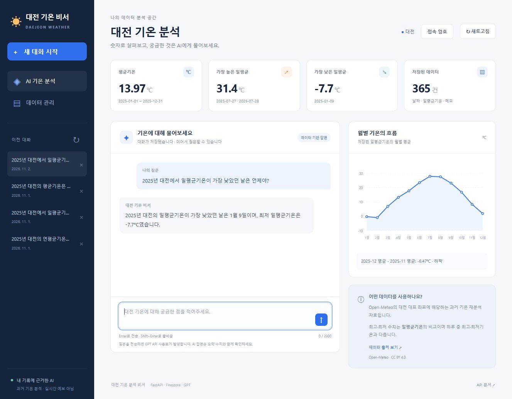
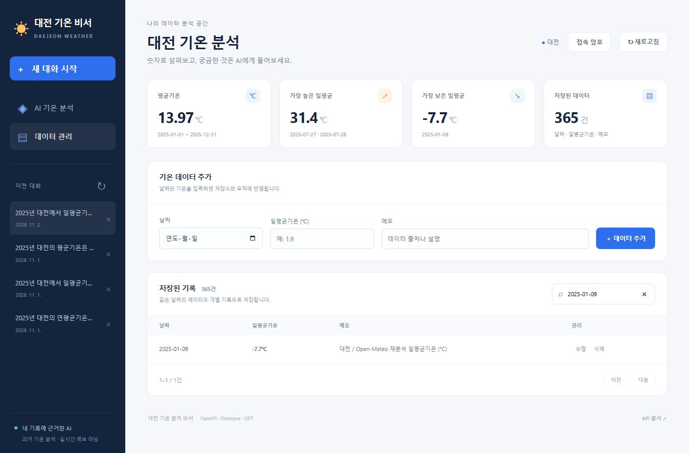
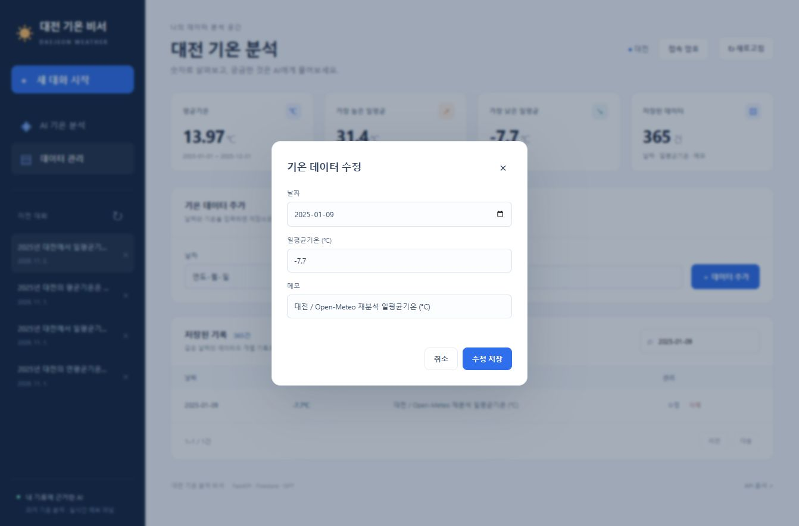
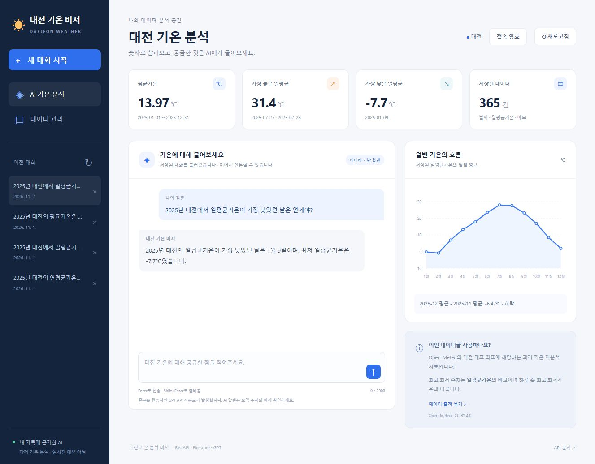

# 대전 기온 분석 AI 비서

대전의 2025년 기온 기록을 관리하고, 저장된 자료의 통계를 근거로 GPT가 질문에 답하는 웹 서비스입니다.

## 기능

- 기온 데이터 추가·조회·수정·삭제
- 전체·월별 평균, 일평균기온의 최대·최소 날짜, 최근 두 달 평균 비교
- 기온 요약을 시스템 지침에 주입한 GPT 답변과 로딩 표시
- Firestore 대화 자동 저장, 목록, 불러오기, 삭제
- 월별 그래프, 날짜·메모 검색, 모바일 화면 대응
- 인터넷 배포 시 접속 암호로 데이터와 GPT 호출 보호

## 기술

Python 3.13 / FastAPI / Pydantic / Firebase Firestore / OpenAI Responses API / HTML·CSS·JavaScript. 프론트엔드 프레임워크를 사용하지 않습니다. 백엔드는 Render, 프론트엔드는 Vercel에 배포합니다.

## 데이터 출처

- [Open-Meteo Historical Weather API](https://open-meteo.com/en/docs/historical-weather-api), [CC BY 4.0](https://creativecommons.org/licenses/by/4.0/)
- 요청 좌표: 대전 대표 좌표 36.3504, 127.3845. 제공 모델의 격자 좌표는 `data/summary.json`에 기록합니다.
- 2025-01-01 ~ 2025-12-31의 일평균기온 365건
- 특정 관측소의 실측치나 대전 전역 평균이 아닌 재분석 자료입니다.
- 연평균기온 13.97℃. 최대·최소는 하루 중 순간 최고·최저가 아닌 일평균기온의 비교입니다.

원본은 `data/open_meteo_2025_raw.json`, 가공 자료는 CSV와 JSON으로 포함합니다. 데이터 관리 후 서비스의 실제 통계는 현재 Firestore 기록으로 다시 계산합니다.

## 배포 주소

| 항목 | 주소 |
|---|---|
| 프론트엔드 (Vercel) | https://daejeon-weather-assistant-frontend.vercel.app/ |
| 백엔드 API (Render) | https://daejeon-weather-assistant.onrender.com/ |
| Swagger UI | https://daejeon-weather-assistant.onrender.com/docs |

접속 암호는 코드나 README에 기재하지 않고 평가자에게 별도로 전달합니다. 이 앱은 동일한 기록을 사용하는 개인 실습용 서비스입니다.

## 로컬 실행

Python 3.10 이상이 필요하며 현재 검증 버전은 3.13.17입니다.

```powershell
python -m venv .venv
.\.venv\Scripts\python.exe -m pip install -r requirements.txt
Copy-Item .env.example .env
```

`.env`에 프로젝트 ID, 인증 파일 경로, OpenAI 키를 설정합니다. 비밀 값은 GitHub에 올리지 않습니다.

```powershell
.\.venv\Scripts\python.exe scripts\import_firestore.py --import-data
.\.venv\Scripts\python.exe -m uvicorn app.main:app --reload
```

웹 화면: http://127.0.0.1:8000/ / API 문서: http://127.0.0.1:8000/docs

초기 입력 스크립트는 기존 날짜 ID의 문서를 덮어쓰지 않습니다. 같은 날짜를 별도 기록으로 추가할 수 있으며, 통계는 저장된 레코드를 모두 포함합니다.

## 환경변수

| 변수 | 위치 | 용도 |
|---|---|---|
| FIREBASE_PROJECT_ID | 로컬 / Render | Firebase 프로젝트 ID |
| GOOGLE_APPLICATION_CREDENTIALS | 로컬 | 서비스 계정 JSON의 로컬 파일 경로 |
| FIREBASE_SERVICE_ACCOUNT_JSON | Render 비공개 설정 | 서비스 계정 JSON 전체. 로컬 경로 대신 사용 |
| OPENAI_API_KEY | 로컬 / Render 비공개 설정 | OpenAI API 키 |
| OPENAI_MODEL | 로컬 / Render | 기본 `gpt-6-luna` |
| APP_ACCESS_TOKEN | Render 비공개 설정 | 16자 이상 접속 암호. API 키와 별개 |
| ALLOWED_ORIGINS | Render | 허용할 Vercel 웹 주소, 쉼표로 구분 |
| API_BASE_URL | Vercel | Render 서버 HTTPS 주소. `/api` 없이 입력 |

실제 키, 인증 파일, 접속 암호는 이 저장소에 포함하지 않습니다. 접속 암호는 브라우저의 현재 화면 메모리에서만 사용하며 저장소에 보관하지 않습니다.

## Render 배포

1. GitHub 저장소를 연결하여 Python Web Service를 생성합니다. Root Directory는 비웁니다.
2. Build Command: `pip install -r requirements.txt`
3. Start Command: `uvicorn app.main:app --host 0.0.0.0 --port $PORT`
4. 무료 플랜을 선택하고 Python 버전은 `3.13.17`, 상태 확인 경로는 `/health`로 설정합니다.
5. 위 환경변수 중 Render 항목을 비공개 환경변수로 입력합니다. API 키와 인증 JSON을 코드에 넣지 않습니다.
6. 처음 ALLOWED_ORIGINS는 `http://localhost:8000`으로 시작할 수 있습니다. Vercel 주소가 생기면 해당 HTTPS 주소로 교체하고 재배포합니다.
7. `/health`, `/docs`에 접속하고 Authorize의 접속 암호에 APP_ACCESS_TOKEN 값을 넣어 API를 확인합니다.

`render.yaml`을 사용한 Blueprint 배포도 지원합니다. Render 환경에서는 접속 암호가 없거나 16자 미만이면 API를 차단합니다. 무료 서비스 첫 접속에는 준비 시간이 걸릴 수 있으며 화면에 대기 안내가 표시됩니다.

## Vercel 배포

1. 같은 GitHub 저장소를 연결합니다.
2. Root Directory: `frontend`, Framework Preset: `Other`
3. API_BASE_URL을 Render의 HTTPS 주소로 설정합니다.
4. `frontend/vercel.json` 설정: Build Command는 `node build.mjs`, Output Directory는 `dist`, Install Command는 비어 있음.
5. 배포 후 Vercel 주소를 Render의 ALLOWED_ORIGINS에 입력해 재배포합니다.
6. Vercel 화면에서 접속 암호를 입력하고 데이터 365건과 기존 대화를 확인합니다.

Vercel에는 API 키, Firebase 인증 JSON, APP_ACCESS_TOKEN 값을 넣지 않습니다. 화면은 공개 API 주소만 포함하도록 빌드합니다.

## API

`POST/GET /api/data`, `PUT/DELETE /api/data/{record_id}`, `GET /api/data/summary`

`POST /api/chat`: message와 선택적 conversation_id를 받습니다. 현재 Firestore 통계 → 시스템 지침에 주입 → GPT 호출 → conversations 자동 저장 순으로 동작합니다.

`POST/GET /api/conversations`, `GET/DELETE /api/conversations/{conversation_id}`

대화 목록에는 messages를 포함하지 않으며 상세 조회에서 전체 메시지를 불러옵니다. 기온 조회와 대화 기록 조회는 GPT를 호출하지 않습니다.

## 구조와 검증

요청 처리, Pydantic 입력 검증, 저장소, 분석, GPT 호출을 모듈로 분리합니다. 오류 응답에 인증 내용을 노출하지 않습니다. 접속 암호가 설정되면 `/api` 기능은 X-App-Token 헤더로 인증합니다.

```powershell
.\.venv\Scripts\python.exe -m unittest discover -s tests -v
```

데이터·채팅·웹 제공·접속 보호 검사 20개를 확인했습니다. 자동 검사는 실제 저장소를 변경하거나 GPT를 호출하지 않습니다. 실제 Firestore CRUD, GPT 답변, 대화 저장·불러오기는 로컬 실습에서도 확인했습니다.

Render와 Vercel 배포 후 실제 웹 화면에서 365건, 연평균 13.97℃, 최고 일평균 31.4℃, 최저 일평균 -7.7℃, 월별 그래프를 확인했습니다. 사용자가 전송한 질문에 GPT가 2025년 1월 9일과 -7.7℃로 답하고 저장된 것을 확인했습니다. 날짜 검색, 수정 입력 창 표시, 기존 대화 불러오기도 배포된 화면에서 확인했습니다. 증빙 캡처를 만드는 동안에는 원본 기온을 변경하지 않았으며 GPT를 추가 호출하지 않았습니다.

GPT 출력 최대 600토큰, 최근 5회 대화만 전달, 질문 최대 2000자, 프로세스당 분당 10회, 자동 재요청 없음으로 설정합니다. 이는 사용료의 절대 상한을 보장하지 않으므로 계정 사용량도 확인합니다.

## 제출 화면

### 1. 데이터 기반 AI 채팅

기온 요약과 그래프, 실제 질문과 GPT 답변, 대화 저장 상태를 함께 확인할 수 있습니다.



### 2. 데이터 관리

실제 Firestore 기록 365건 중 `2025-01-09`를 검색해 일평균기온 -7.7℃와 출처 메모를 조회했습니다. 추가 입력란과 수정·삭제 버튼도 함께 표시됩니다.



수정 버튼을 눌러 기존 데이터가 입력란에 표시되는 것을 확인한 화면입니다. 이 캡처에서는 원본을 보존하기 위해 저장하지 않고 취소했습니다.



### 3. 대화 기록 불러오기

왼쪽 목록에서 이전 대화를 선택해 질문과 답변이 다시 표시되고, 상단에 `저장된 대화를 불러왔습니다` 안내가 나타난 화면입니다.



서비스에 접속하려면 APP_ACCESS_TOKEN으로 설정한 접속 암호가 필요합니다. 평가자에게 암호와 비공개 저장소 열람 권한을 별도로 전달합니다. API 키와 Firebase 인증 정보는 제출하지 않습니다.
